# ImageJ user guide: illustrated walkthrough

**Owner:** Dhriti (M3) · **ImageJ version:** 1.54 · **Status:** complete

This guide walks through the main parts of ImageJ using its built-in sample pictures. Every step has a screenshot, so the guide works without running ImageJ. The one-page version is `cheat-sheet.md`.

Menu names were checked against `ij.jar` 1.54. Shortcuts: on a Mac, use Cmd instead of Ctrl.

## How to get the sample pictures

**File > Open Samples** lists free built-in pictures. They download from the internet, so open them while online. We use:

| Picture | Used in |
|---|---|
| Clown | Steps 1 to 3 |
| Leaf (with noise added) | Step 4 |
| Boats | Step 5 |
| Blobs | Steps 6 to 8 |

To get the noisy picture: open Leaf, then **Process > Noise > Add Noise**.

## 1. Open a picture

**File > Open...** (Ctrl+O) or **File > Open Samples > Clown**.

ImageJ is a free program for looking at and measuring pictures. It opens many formats (TIFF, JPEG, GIF, PNG and more).

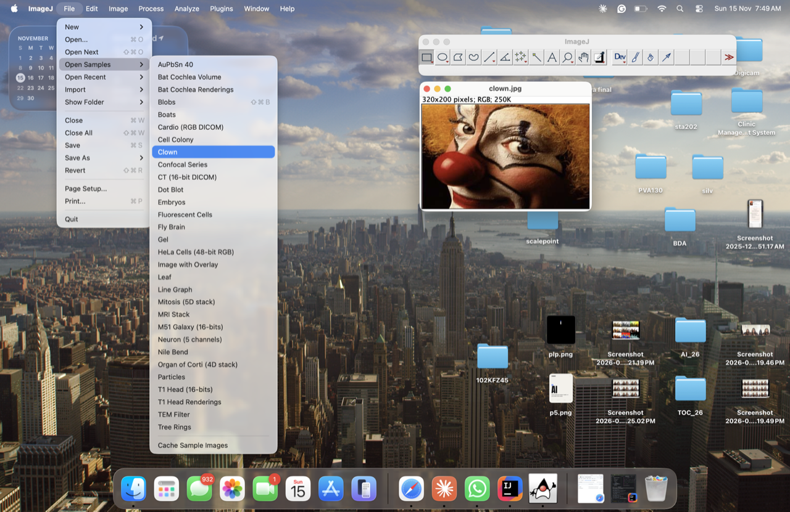

## 2. The window

| Part | What it is |
|---|---|
| Menu bar | File, Edit, Image, Process, Analyze, Plugins, Window, Help |
| Toolbar | Row of tool icons (select, zoom, draw, ...) |
| Status bar | Position and pixel value under the mouse |
| Picture window | The image you work on |

Move the mouse over the picture and the status bar shows the position and the brightness of each point. No screenshot is needed for this step.

## 3. Grey pictures and the histogram

**Image > Type > 8-bit** turns the picture grey. A picture is a grid of numbers. In 8-bit, each point is a brightness from 0 (black) to 255 (white).

**Analyze > Histogram** (Ctrl+H) shows how many points have each brightness.

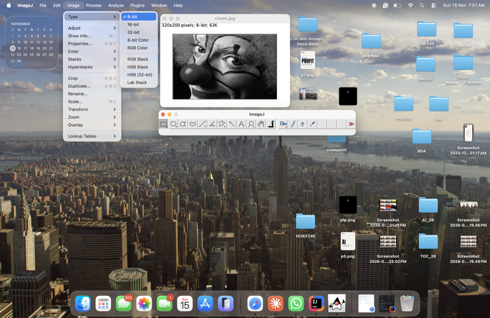

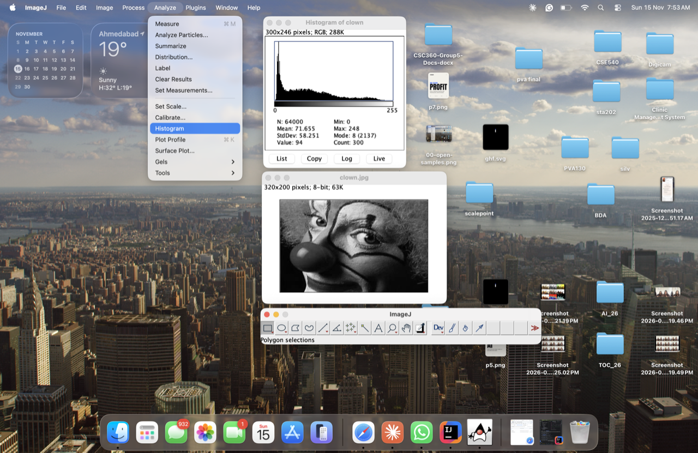

## 4. Blur to remove noise

Open the noisy Leaf. **Process > Filters > Gaussian Blur...**, tick **Preview** and move the **Sigma** slider (try 2). Bigger Sigma = smoother. Click **OK**.

**Edit > Undo** (Ctrl+Z) brings the original back.

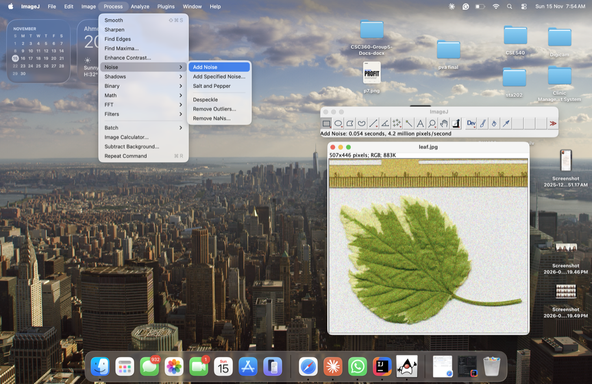

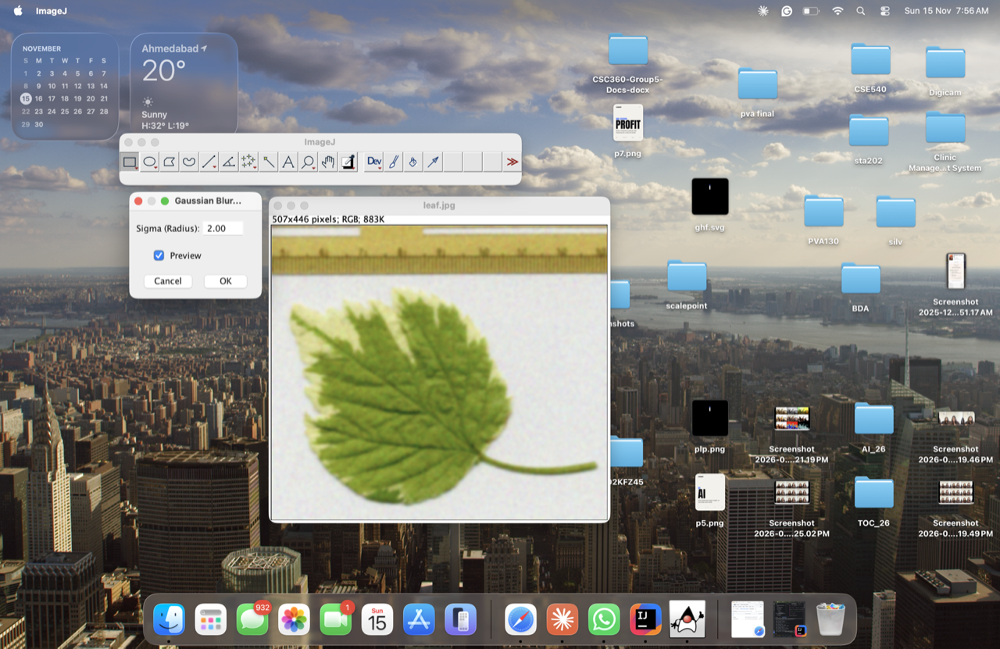

## 5. Find outlines

Open Boats. **Process > Find Edges**. The result is bright where brightness changes fast, which marks the outlines of things.

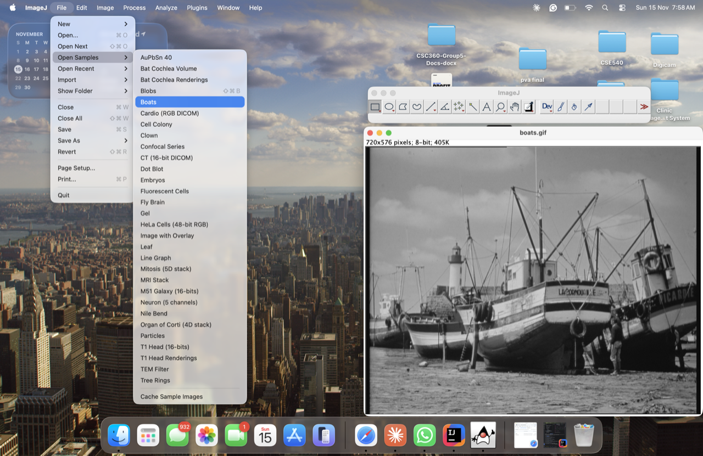

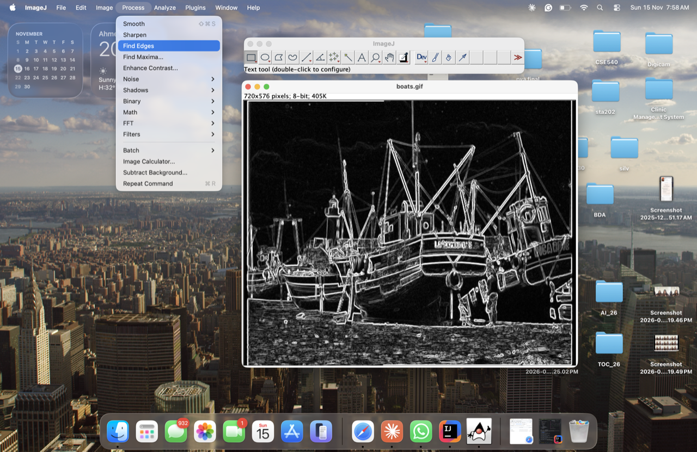

## 6. Threshold: object or background

Open Blobs. **Image > Adjust > Threshold...** (Ctrl+Shift+T). Move the sliders until only the shapes are red, or click **Auto**. Click **Apply** to make the picture black and white.

Blobs uses an inverting LUT, so if the threshold looks backwards, click **Auto** or tick **Dark background**.

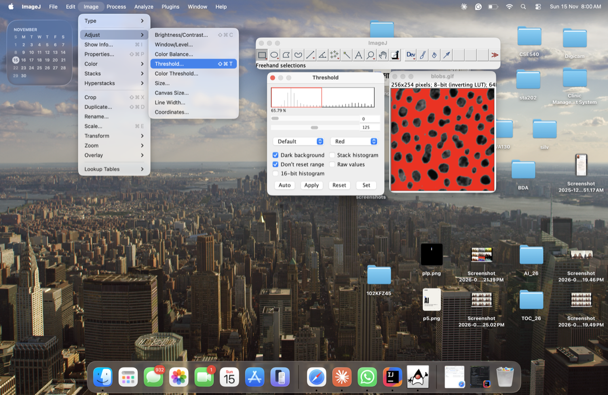

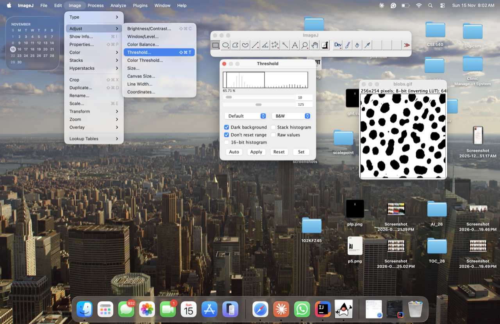

## 7. Count and measure shapes

**Analyze > Analyze Particles...**, tick **Display results** and **Summarize**, click **OK**. The Results window lists each shape and its size, and the Summary window gives the count.

This is what scientists use ImageJ for: counting cells, measuring areas.

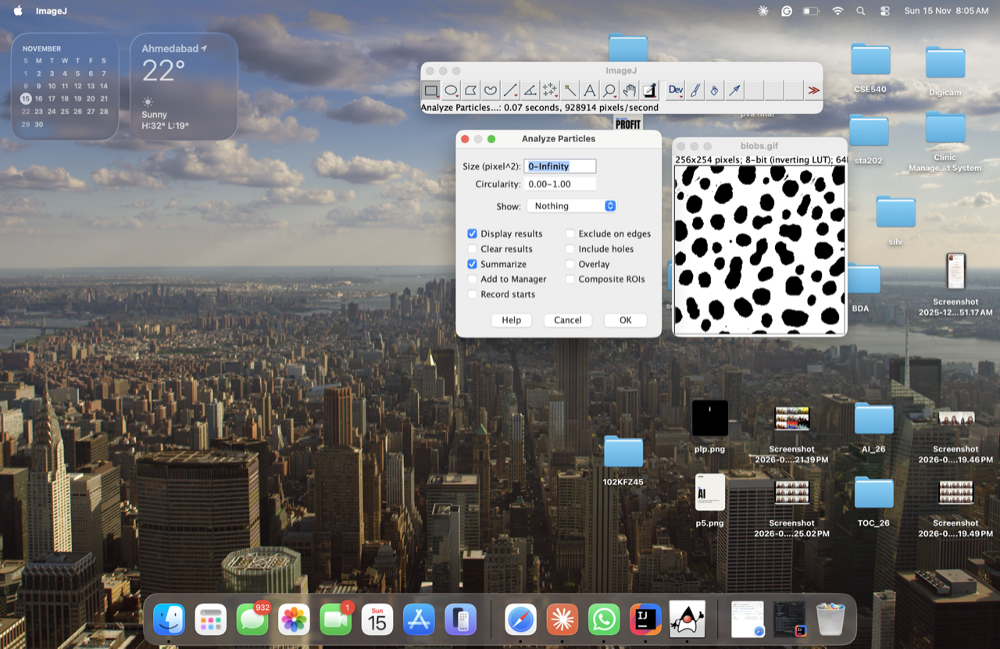

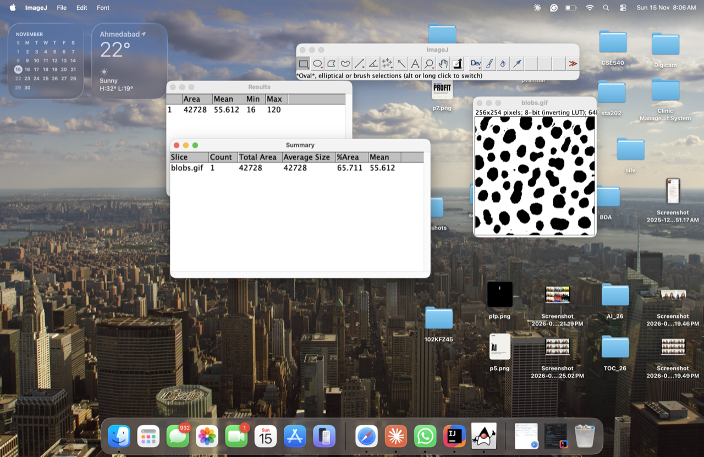

## 8. Record a macro

A macro is a recording of steps. Do the work once and ImageJ repeats it on any other picture.

1. **Plugins > Macros > Record...** (Ctrl+U).
2. Run **Gaussian Blur** (sigma 2), then **Find Edges**.
3. In the Recorder window, click **Create**.
4. Open another picture and run the macro from the editor with **Macros > Run Macro**, or from **Plugins > Macros > Run...**.

The recorded code looks like this:

```
run("Gaussian Blur...", "sigma=2");
run("Find Edges");
```

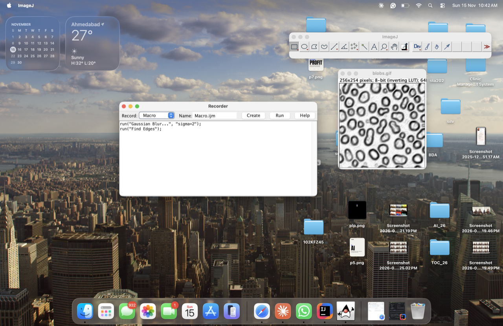

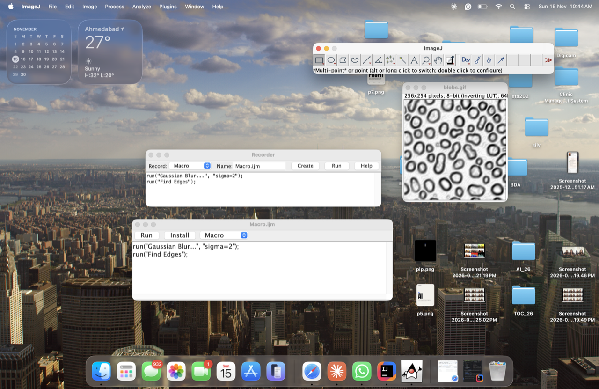
