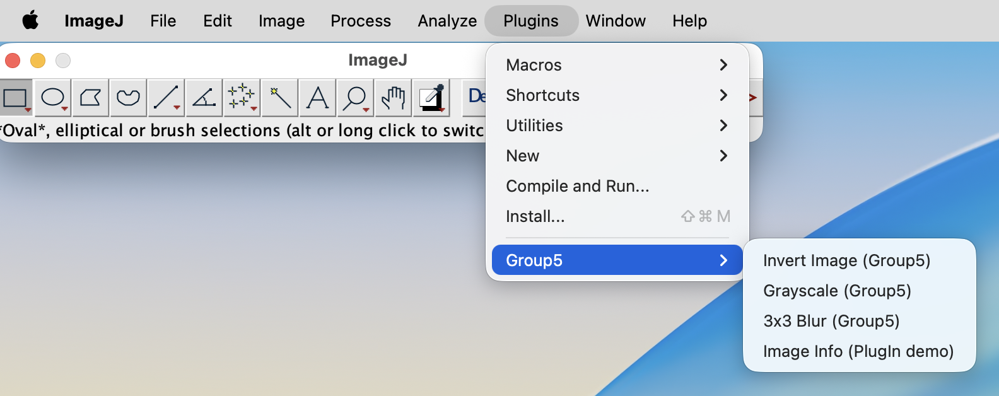
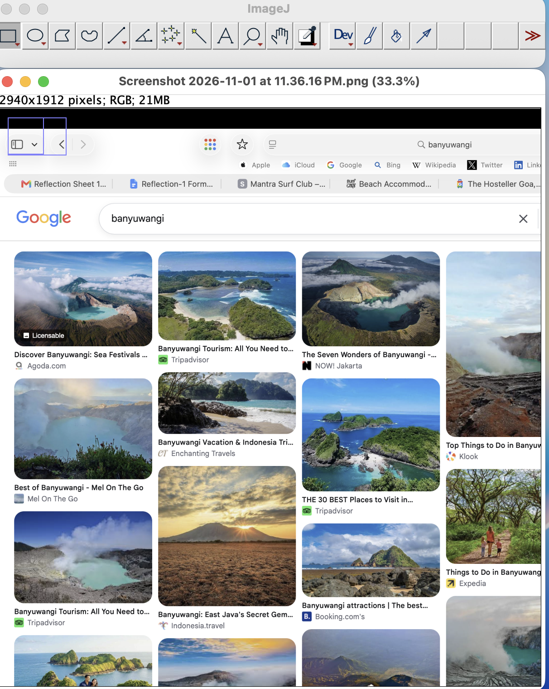
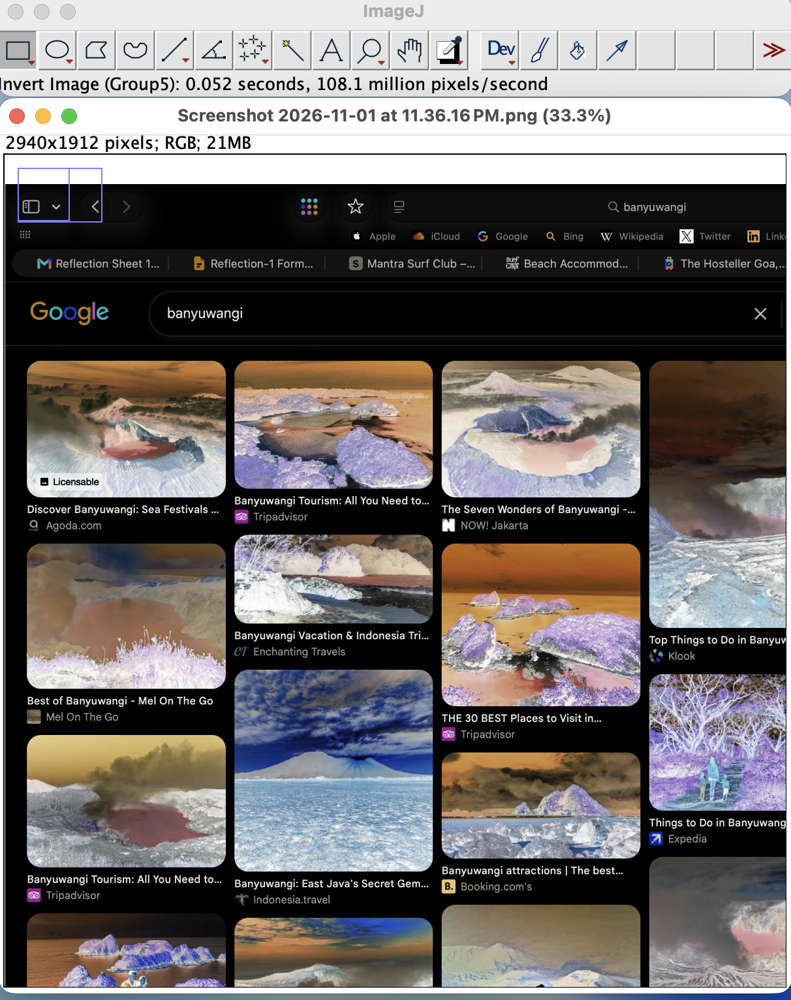
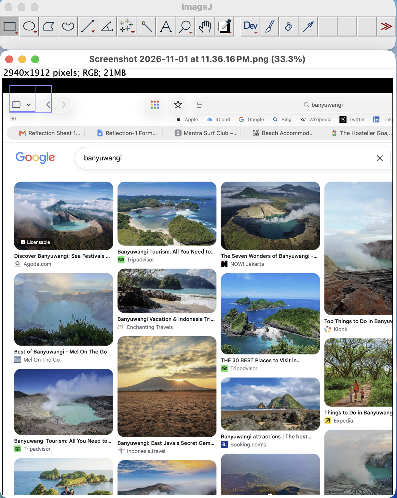
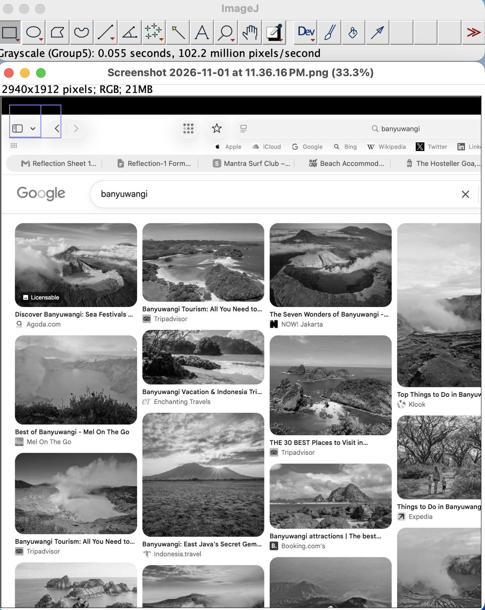
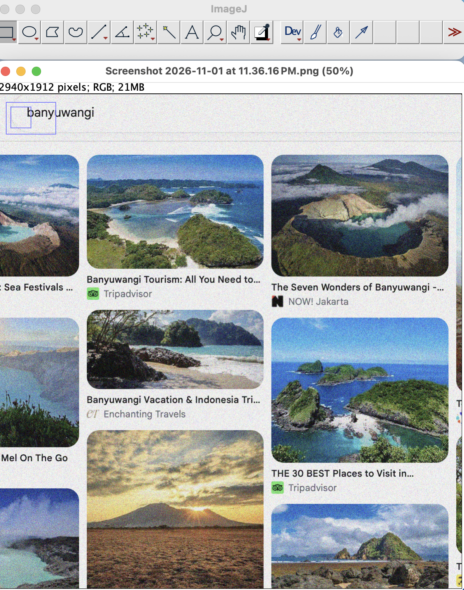
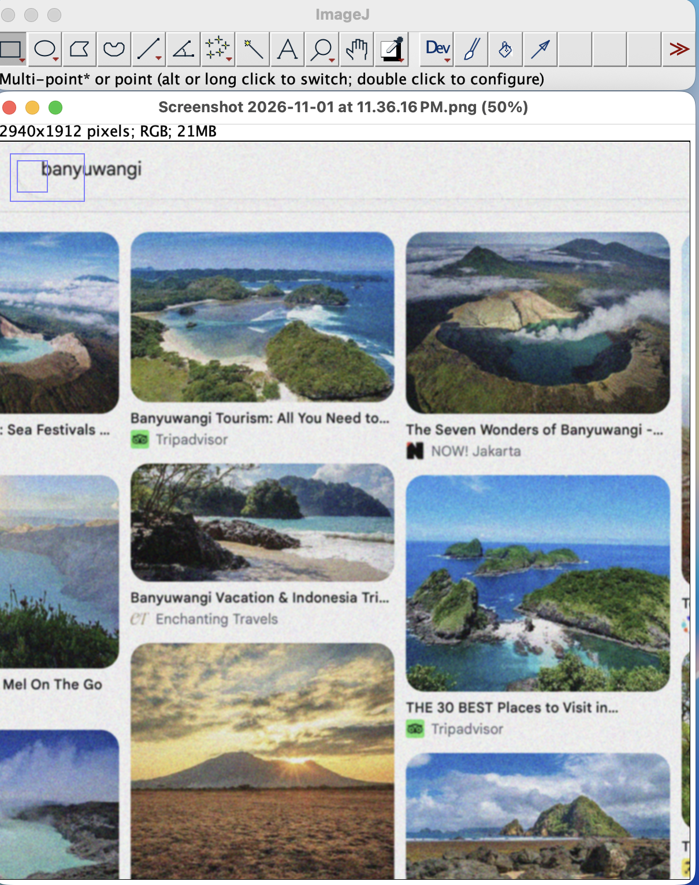
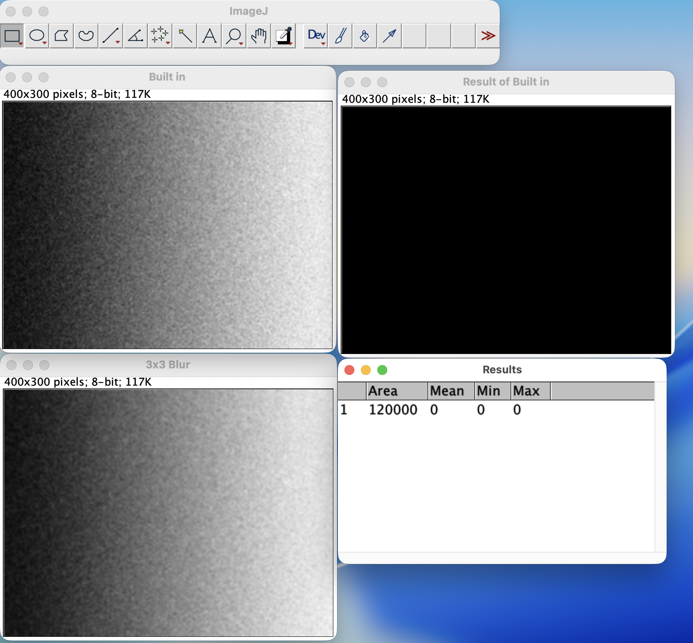
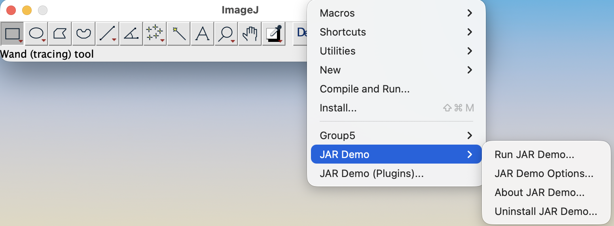

# 4-plugins: ImageJ plugins (Group 5)

Plugin source project. Plain `javac`, no Maven/Gradle. Owner: Member 4 (Aangi).

## Build

```
cd 4-plugins
./build.sh fetch   # downloads ij.jar (v1.54p) to lib/ (git-ignored)
./build.sh         # compiles src/ -> out/ and builds out/plugins/Group5_Plugins.jar
./build.sh run     # launches ImageJ with the plugins available
```

Output jar: `out/plugins/Group5_Plugins.jar`.
Tested with: OpenJDK 21 and 25 / ImageJ 1.54p.
Windows: `build.sh` needs bash. Use Git Bash or WSL. Build it there, then copy the jar into ImageJ's `plugins/` folder.

## Plugin status

| Plugin | Menu entry | Type | 8-bit | RGB | ROI | Undo | Status |
| --- | --- | --- | --- | --- | --- | --- | --- |
| Invert_Image | Plugins > Group5 > Invert Image (Group5) | PlugInFilter | yes | yes | yes | yes | working |
| Grayscale_Convert | Plugins > Group5 > Grayscale (Group5) | PlugInFilter | no (RGB only) | yes | yes | yes | working |
| Blur_3x3 | Plugins > Group5 > 3x3 Blur (Group5) | PlugInFilter | yes | yes | yes | yes | working; matches built-in Mean (radius 1) |
| Image_Info | Plugins > Group5 > Image Info (PlugIn demo) | PlugIn | any | any | n/a | n/a | working |


Screenshots (in `img/`):


 
 
 



## PlugIn vs PlugInFilter

| | PlugIn | PlugInFilter |
| --- | --- | --- |
| Interface | `ij.plugin.PlugIn` | `ij.plugin.filter.PlugInFilter` |
| Entry point | `void run(String arg)` | `int setup(String arg, ImagePlus imp)` then `void run(ImageProcessor ip)` |
| Gets | nothing; finds the image itself with `IJ.getImage()` | the current image's processor |
| Use for | dialogs, opening files, creating new images, anything that is not "process this image" | filters that change the pixels of the current image |
| ImageJ handles | nothing | image type check, undo snapshot, ROI/mask, stacks (via flags) |

`setup()` returns flags telling ImageJ what the plugin supports:

| Flag | Meaning |
| --- | --- |
| DOES_8G | accepts 8-bit grayscale |
| DOES_RGB | accepts RGB colour |
| SUPPORTS_MASKING | respects non-rectangular selections (ImageJ restores pixels outside the mask) |
| DOES_STACKS | run on every slice of a stack when asked |
| NO_CHANGES | plugin does not modify the image (no undo snapshot needed) |

Small PlugIn example: `src/Image_Info.java` (opens a dialog, reads the image with `IJ.getImage()`, changes nothing).

Class names must contain an underscore (`Blur_3x3`), otherwise ImageJ does not list them in the menu. Menu entries come from `src/plugins.config`:

```
Plugins>Group5, "3x3 Blur (Group5)", Blur_3x3
```

## The plugins

### Invert_Image
Replaces each pixel by its inverse (255 - v for 8-bit). Starter plugin, kept from the repo.

### Grayscale_Convert
Y = 0.299 R + 0.587 G + 0.114 B, then R = G = B = Y.
Trade-off (Option A): a PlugInFilter cannot change an image's type, so the result stays RGB but looks gray. Use Image > Type > 8-bit afterwards for a true 8-bit image.
Compared with Image > Type > 8-bit: ImageJ's default is an unweighted average (R+G+B)/3. Our values follow the luminance weights, which match human perception (green counts most). Enable weighted conversions in Edit > Options > Conversions to make ImageJ use similar weights.
Check values: pure red -> 76, pure green -> 150, pure blue -> 29.

### Blur_3x3
3x3 mean filter by hand: convolution with 1/9 * [[1,1,1],[1,1,1],[1,1,1]].
- Reads from `ip.duplicate()`, writes to the original. Without the copy, blurred pixels feed into their neighbours and the result is wrong (smeared toward the bottom-right).
- Borders: coordinates are clamped to the image edge (edge pixels repeated).
- Rounding: `(sum + 4) / 9` rounds to nearest, as ImageJ does.
- 8-bit and RGB (each channel separately). Only pixels inside the selection are changed.
- Verified: result is identical to ImageJ's built-in `ip.filter(BLUR_MORE)` on random 8-bit and RGB images (max difference 0).
- Live proof: duplicate the image, run Process > Filters > Mean... (radius 1) on the copy, then Process > Image Calculator > Difference. The result is black.

Extending to Gaussian or any kernel: replace the nested dx/dy sums by a loop over a kernel array `k[dy+1][dx+1]` and divide by the kernel sum.

## Installing an existing plugin

1. Download a plugin `.jar` (or `.class`) in advance. Example used in our demo: **JAR Demo** (`jar_demo.jar`) from https://imagej.net/ij/plugins/jar-demo.html (official, tiny, installs a "JAR Demo" submenu under Plugins).
2. Copy it into ImageJ's `plugins/` folder (it sits next to `ij.jar`; if you run from the jar, it is the `plugins/` folder beside it; on Mac with ImageJ.app, open the app bundle via right-click > Show Package Contents and look for `plugins/`). A jar needs an underscore in its name.
3. Restart ImageJ (or Help > Refresh Menus).
4. Check: Plugins menu shows the new entry. Also: Plugins > Install... (installs a file for you) and Plugins > Compile and Run... (compiles a `.java` file).

Our own `Group5_Plugins.jar` installs the same way.

## Debugging a plugin
`IJ.log("x=" + x)`, `IJ.showMessage(...)`, or run from an IDE with `ij.ImageJ` as the main class and the plugin on the classpath.

## Tests
`test/PluginTest.java` is a headless self-test (no GUI) comparing our plugins to ImageJ built-ins:

```
javac -cp lib/ij.jar -d out src/*.java test/PluginTest.java
java -Djava.awt.headless=true -cp out:lib/ij.jar PluginTest
```
