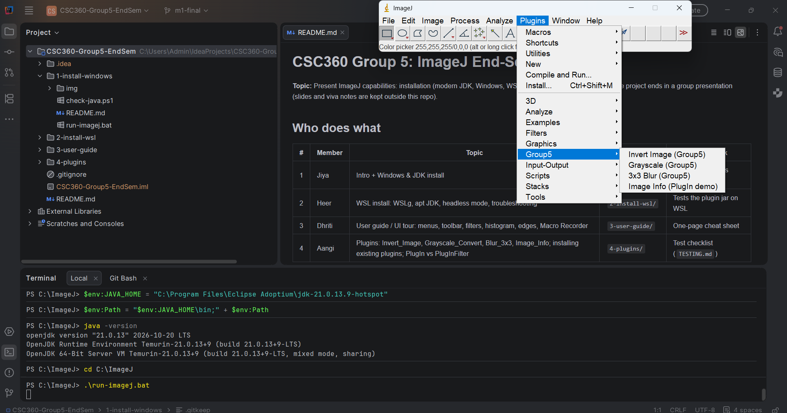
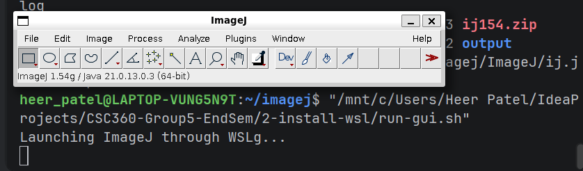
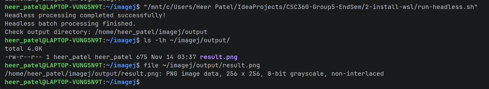
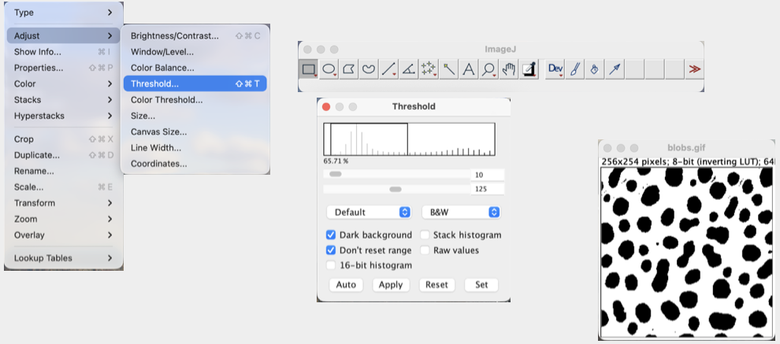
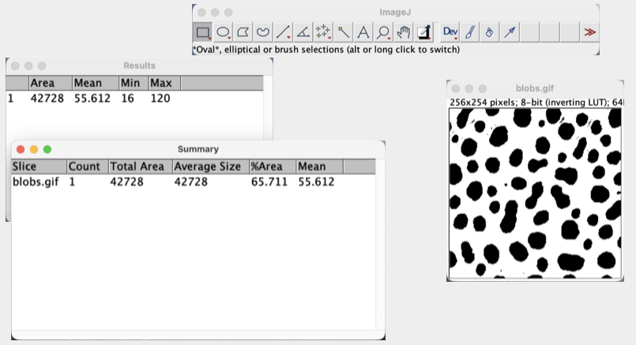
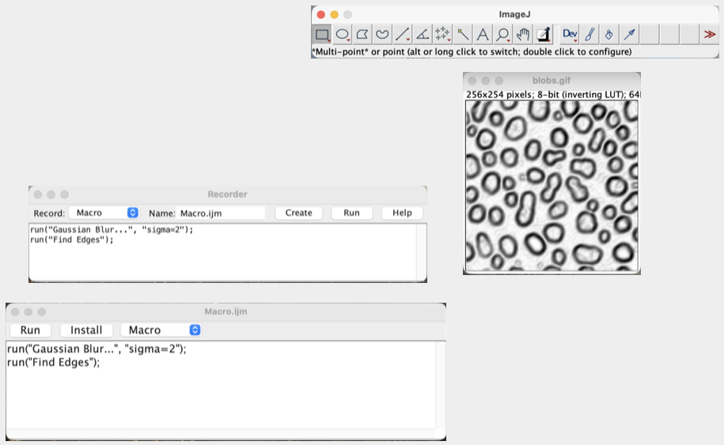
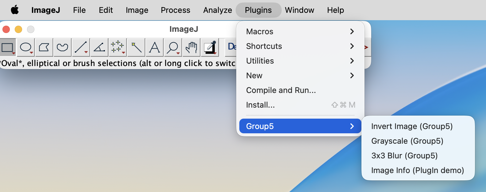
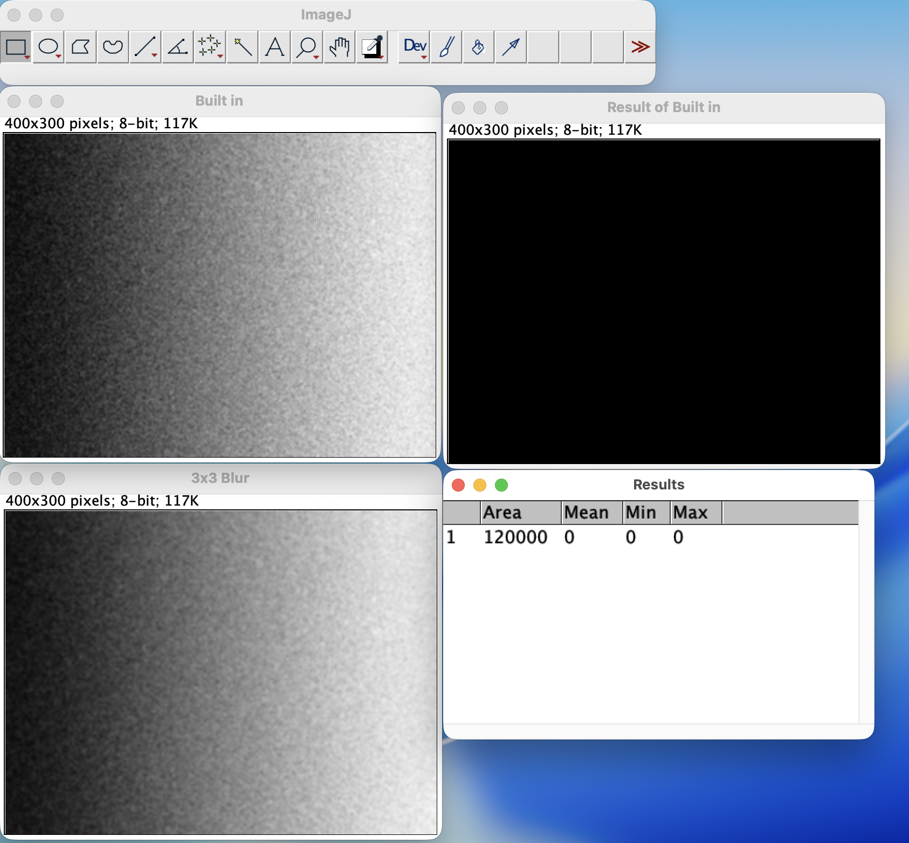

# CSC360 Group 5: ImageJ End-Sem Project

**Topic:** Present ImageJ capabilities: installation (modern JDK, Windows, WSL), user guide (UI), and plugins.
The project ends in a group presentation (slides and viva notes are kept outside this repo).

## Who does what

| # | Member   | Topic | Folder | Shared task |
|---|----------|-------|--------|-------------|
| 1 | Jiya   | Intro + Windows & JDK install | `1-install-windows/` | Intro and Windows guide |
| 2 | Heer   | WSL install: WSLg, apt JDK, headless mode, troubleshooting | `2-install-wsl/` | Tests the plugin jar on WSL |
| 3 | Dhriti  | User guide / UI tour: menus, toolbar, filters, histogram, edges, Macro Recorder | `3-user-guide/` | One-page cheat sheet |
| 4 | Aangi   | Plugins: Invert_Image, Grayscale_Convert, Blur_3x3, Image_Info; installing existing plugins; PlugIn vs PlugInFilter | `4-plugins/` | Test checklist (`TESTING.md`) |

## Highlights

A quick visual tour of the project. Each folder's README has the full step-by-step guide.

### 1. Installation on Windows (modern JDK)



*Temurin JDK 21 is active (`java -version`, bottom), ImageJ was launched with `run-imagej.bat`, and our plugins appear under **Plugins > Group5**.*

### 2. Installation on WSL (WSLg GUI and headless mode)



*The ImageJ window is running from a WSL Ubuntu shell on Java 21 and shown on the Windows desktop via WSLg.*



*Headless mode (no GUI): the script processes an image and writes `result.png`, confirmed with `ls` and `file`. This is how ImageJ runs on servers or in automation.*

### 3. User guide (UI tour)



*Image > Adjust > Threshold turns the grayscale blobs sample into a binary mask. The menu, the dialog with histogram, and the result are all visible.*



*The thresholded image is then measured with Analyze Particles: Results and Summary tables give area, mean and %Area.*



*The Macro Recorder logs our clicks (`Gaussian Blur...`, `Find Edges`) as code, which is turned into a reusable macro (Macro.ijm) and applied to the image.*

### 4. Plugins (our own Java code)



*Our four plugins (Invert Image, Grayscale, 3x3 Blur, Image Info) are installed and listed under **Plugins > Group5**.*



*Verification: the original noisy image (top left), our 3x3 Blur result (bottom left), and the difference against ImageJ's built-in blur (top right, all black). The Results table shows Mean = Min = Max = 0, so the output is identical to the built-in filter.*

## Repo layout

```
1-install-windows/   Windows + JDK install notes, screenshots
2-install-wsl/       WSL install notes, screenshots
3-user-guide/        UI tour notes, cheat sheet
4-plugins/           Plugin source, tests, screenshots (see its README)
```

## Workflow

- One branch per member (e.g. `m1-windows`, `m2-wsl`, `m3-userguide`, `m4-plugins`).
- Open a PR into `main`; don't push to `main` directly.
- `ij.jar` is git-ignored. Each person fetches it locally (see `4-plugins/README.md`).
